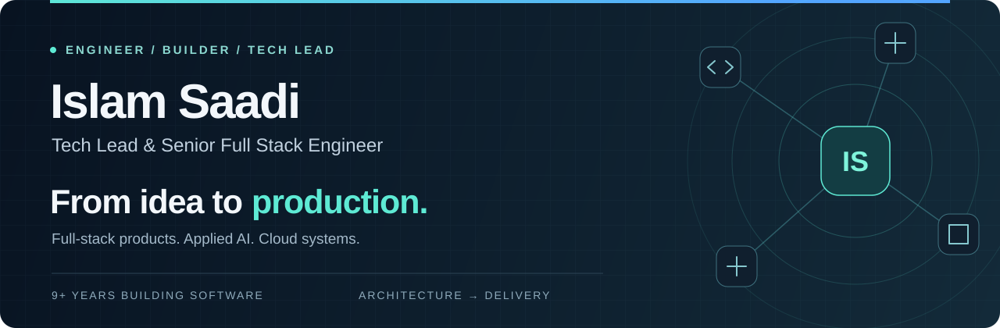

  

  
  &nbsp;
  

  <a href="#selected-public-projects">Selected projects</a> &nbsp; / &nbsp;
  <a href="#production-work">Production work</a> &nbsp; / &nbsp;
  <a href="#my-toolkit">Tech stack</a> &nbsp; / &nbsp;
  <a href="#lets-connect">Let's connect</a>

---

## Software that solves the whole problem.

I'm **Islam Saadi**, a **Tech Lead & Senior Full Stack Engineer at [iRestWEB](https://irestweb.com/)**. I bring **9+ years of experience** building web applications and cloud systems, from the first architecture decision to the services, interfaces and infrastructure that run them.

My work connects **full-stack engineering, production AI and cloud operations**. I lead developers, stay hands-on with the code, and turn complex business requirements into software people can use.

<table>
<tr>
<td width="33%" valign="top">
<h3>01 / Product engineering</h3>

Multi-tenant SaaS, business platforms, APIs and responsive interfaces. Clear boundaries, reliable data flows and thoughtful user experiences.

</td>
<td width="33%" valign="top">
<h3>02 / Applied AI</h3>

AI agents, RAG, MCP and LLM tool use. Practical workflows with validation, spend controls, audit logs and human review where it matters.

</td>
<td width="33%" valign="top">
<h3>03 / Cloud & leadership</h3>

AWS, Kubernetes, event-driven services and CI/CD. Architecture ownership, code reviews, mentoring and production problem-solving.

</td>
</tr>
</table>

## Selected public projects

A closer look at how I build, across business logic, AI, cloud infrastructure and mobile development.

<table>
<tr>
<td width="50%" valign="top">
<h3><a href="https://github.com/islamsaadi/task-multi-vendor">Multi-Vendor Commerce</a></h3>

A commerce engineering demo with a dynamic pricing engine, vendor order splitting, stock reservations, idempotent requests and a transactional outbox.

<code>Laravel</code> <code>React</code> <code>TypeScript</code> <code>MySQL</code>

<a href="https://github.com/islamsaadi/task-multi-vendor#3-decisions-and-why">Explore the architecture →</a>
</td>
<td width="50%" valign="top">
<h3><a href="https://github.com/islamsaadi/trekgo-backend">TrekGO / AI Travel API</a></h3>

AI-assisted itinerary generation with authentication, trip management, weather data and route planning integrations.

<code>Node.js</code> <code>Express</code> <code>MongoDB</code> <code>Groq</code>

<a href="https://github.com/islamsaadi/trekgo-backend">Explore the backend →</a>
</td>
</tr>
<tr>
<td width="50%" valign="top">
<h3><a href="https://github.com/islamsaadi/devops_final_project">Cloud Deployment / DevOps</a></h3>

A team project deploying a containerized Node.js application and MongoDB on AWS EKS, with persistent storage and Prometheus/Grafana monitoring.

<code>AWS EKS</code> <code>Docker</code> <code>Kubernetes</code> <code>Grafana</code>

<a href="https://github.com/islamsaadi/devops_final_project">Explore the infrastructure →</a>
</td>
<td width="50%" valign="top">
<h3><a href="https://github.com/islamsaadi/trekgo-frontend">TrekGO / Travel Experience</a></h3>

A responsive travel planner with interactive maps, route views, weather information and saved itineraries. The UI companion to the TrekGO API.

<code>React</code> <code>Vite</code> <code>Material UI</code> <code>Leaflet</code>

<a href="https://github.com/islamsaadi/trekgo-frontend">Explore the frontend →</a>
</td>
</tr>
<tr>
<td width="50%" valign="top">
<h3><a href="https://github.com/islamsaadi/EasyExporter">EasyExporter / Android Library</a></h3>

Reusable CSV, JSON and PDF exports with field selection, filtering, progress callbacks, localization and RTL layouts.

<code>Java</code> <code>Android</code> <code>PDF</code> <code>RTL</code>

<a href="https://github.com/islamsaadi/EasyExporter">Explore the library →</a>
</td>
<td width="50%" valign="top">
<h3><a href="https://github.com/islamsaadi/zerospy">ZeroSpy / Android Privacy</a></h3>

An Android project exploring camera and microphone activity monitoring, SMS link reputation checks, notifications and security event logs.

<code>Java</code> <code>Android</code> <code>APIVoid</code> <code>Privacy</code>

<a href="https://github.com/islamsaadi/zerospy">Explore the application →</a>
</td>
</tr>
</table>

## Production work

Alongside these public repositories, my professional work at iRestWEB includes:

- **AI quoting for manufacturing** — an agent that reads customer drawings, drafts priced quotes and generates laser-ready production files, with queued workflows, spend limits and audit logs.
- **Factory management** — quotes, orders, production tracking, suppliers and accounting integrations, built with Laravel, Vue.js, MySQL and AWS S3.
- **Dental clinic SaaS** — tenant isolation, medical records, scheduling, billing, role-based permissions and audit trails.
- **Distributed services** — Java/Spring Boot microservices, Kafka event flows and Kubernetes deployments on AWS.

[More about my experience on LinkedIn →](https://www.linkedin.com/in/islamsaadi/)

## My toolkit

| Area | Technologies & practices |
| :--- | :--- |
| **Backend** | Java · Spring Boot · Node.js · Express · PHP · Laravel · REST APIs |
| **Frontend** | React · Vue.js · TypeScript · JavaScript · Responsive UI |
| **AI engineering** | AI agents · RAG · MCP · LLM tool use · Embeddings · Prompt engineering |
| **Data & messaging** | PostgreSQL · MySQL · MongoDB · Apache Kafka |
| **Cloud & delivery** | AWS · Docker · Kubernetes / EKS · GitHub Actions · Jenkins · CI/CD |
| **Security** | IAM · AWS KMS · RBAC · OAuth2 / JWT · Tenant isolation · Audit trails |
| **Mobile** | Android · Java · Reusable libraries · Localization & RTL |

**B.Sc. in Software Engineering** — Afeka College of Engineering  
Additional training in **Generative AI**, **Java Microservices & Cloud Development**, and **DevOps Engineering**.

## Let's connect

Interested in full-stack products, AI workflows or cloud architecture? Let's talk about the problem you're solving.

**[Connect on LinkedIn ↗](https://www.linkedin.com/in/islamsaadi/)** &nbsp; · &nbsp; **[Explore iRestWEB ↗](https://irestweb.com/)**

Architecture with purpose. Code with care. Ownership through production.
